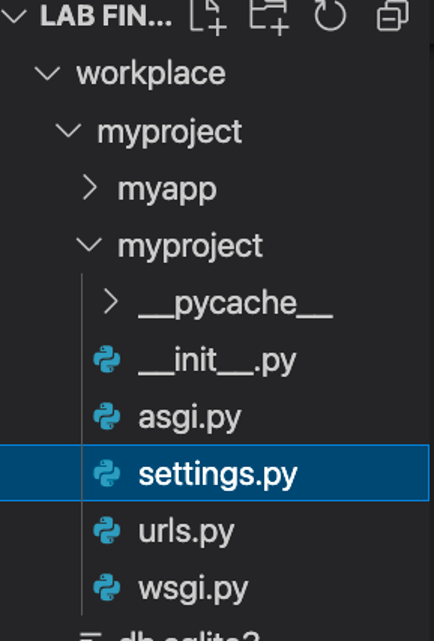

# Connect the Little Lemon back-end to MySQL

## **Lab assets**

You are provided with a basic setup for the Django environment for the project and app inside the zip file below.

[Connect-the-Little-Lemon-backend-to-MySQL.zip](Connect-the-Little-Lemon-backend-to-MySQL.zip)

The zip has been extracted to the folder **[C7M3L2 Lab /myproject](C7M3L2%20Lab%20/myproject/)**. This is the working directory for the lab (it contains **manage.py**). Run all commands from inside it:

```bash
cd "C7M3L2 Lab /myproject"
```

**Note:** *The folder name `C7M3L2 Lab ` ends with a **space**, so always put the path in quotes.*

The zip file contains an updated template to be used along with supportive files to run the lab.

**Note:** *The virtual environment using **pipenv** is defined by the [Pipfile](C7M3L2%20Lab%20/myproject/Pipfile) and [Pipfile.lock](C7M3L2%20Lab%20/myproject/Pipfile.lock) in the extracted folder. The virtual environment itself is not included. You must create and activate it and make sure the dependencies are installed.*

### **Extracted project structure**

```
C7M3L2 Lab /myproject/
├── manage.py
├── Pipfile                     # django, mysqlclient; python_version = "3.9"
├── Pipfile.lock
├── db.sqlite3                  # default SQLite database, replaced by MySQL in this lab
├── myproject/                  # project
│   ├── settings.py             # ← YOU EDIT: INSTALLED_APPS (Step 11), DATABASES (Steps 12–13)
│   └── urls.py                 # only the admin/ route
└── myapp/                      # app
    ├── models.py               # Booking model (starter code)
    ├── forms.py                # BookingForm (starter code, not used in this lab)
    ├── admin.py, apps.py, tests.py
    ├── urls.py                 # empty
    ├── views.py                # empty
    └── migrations/             # only __init__.py, no migrations yet
```

Your goal is to create a MySQL database and connect a Django project to it.

## **Objectives**

- Create new MySQL database credentials
- Update the project settings in Django to enable connection with MySQL
- Migrate models and update the database table

## **Introduction**

In this lab, you will create an external MySQL database and connect a Django project to it. You will migrate your models and fill the database with the booking times available on the Little Lemon website.

Later in the assessment, you will build a booking option on the Little Lemon website. It will use JavaScript in the Django templates and the MySQL database as the back-end. This is part one of the final assessment, where you set up the database connection.

## **Initial lab instructions**

This lab will require you to modify the following files:

[myproject/settings.py](C7M3L2%20Lab%20/myproject/myproject/settings.py)



You will also look at [myapp/models.py](C7M3L2%20Lab%20/myproject/myapp/models.py). It already has the code you need, so you don't have to change it.

You will also need to use the terminal inside VS Code.

If it isn't open already, go to **Terminal** on the menu bar at the top of your screen and select **New Terminal**.


Before you begin this lab, you must activate the virtual environment.

You have already built the project named **myproject** and added an app inside the project called **myapp**.

Follow the instructions below and check the output after every step.

### **Starter code notes (from the extracted files)**

- **settings.py** still uses the default SQLite database, and `myapp` is **not** yet in `INSTALLED_APPS`. Steps 11–13 fix both.
- **Booking model** in [models.py](C7M3L2%20Lab%20/myproject/myapp/models.py) has these fields: `first_name` (CharField, max 200), `reservation_date` (DateField) and `reservation_slot` (SmallIntegerField, default 10).
- **Migrations:** `myapp/migrations/` has only `__init__.py`, so `makemigrations` will create `0001_initial.py` for `Booking`.
- **myapp/urls.py** is empty. Don't add `include('myapp.urls')` to the project `urls.py` in this lab. Django would raise an error because the file has no `urlpatterns`.
- **Pipfile** asks for Python **3.9**. If you have a different Python version, run `pipenv --python 3` (or edit `python_version`) before you install.
- **Later labs:** the [Setup](../Setup/) and [Display](../Display/) starter projects connect as `root` with the password `root@123` to the same `reservations` database. You can switch their settings to the `admindjango` user you create here.

# **Steps**

**Note:** *Make sure you have installed MySQL on your local machine and set up the admin user. To keep this lab simple, you will start with the **root** user. By default, the root user's password is either **password** or blank. If the password is blank, press **Enter**. The password does not appear on screen as you type it.*

**Step 1:**

Open the command line or terminal on your local machine and log in to the **mysql** shell with the command:

**mysql -u root -p**

Press Enter and type the password when prompted.

**Note:** On some machines you may need admin privileges for this command. To get them, add the keyword sudo before the command. For example:

**sudo mysql -u root -p**

**Step 2:**

Create a database named **reservations** with the command below:

**CREATE DATABASE reservations;**

**Note:** *Commands in MySQL must end with a semicolon (;).*

**Step 3:**

Next, check that the database was created by typing the command:

**SHOW DATABASES;**

The output depends on the databases on your local machine. Confirm that it includes the database you created.

**Step 4:**

Now open VS Code and open the **Terminal** inside it. Go to the project directory of your Django project (`C7M3L2 Lab /myproject`) and activate the **pipenv** virtual environment for the project:

```bash
pipenv install
pipenv shell
```

**Note:** Make sure the **Pipfile** created by **pipenv** includes the **mysqlclient** and **Django** packages, along with any other dependencies your local machine needs to run the project. The extracted Pipfile already lists both. On macOS, `mysqlclient` needs the MySQL client libraries to build (for example, `brew install mysql pkg-config`).

**Step 5:**

In the terminal, run the command that opens the **mysql** shell. Pass the **-u** flag for the user and the **-p** flag so that the MySQL console asks for a password:

**mysql -u root -p**


**Note:** *The password here is the one set for the **root** user on your local machine.*

**Step 6:**

Run the command to show databases (`SHOW DATABASES;`) and make sure the **reservations** database you created is in the list.

**Step 7:**

Create a new user for the database by running the following command:

**CREATE USER 'admindjango'@'localhost' IDENTIFIED BY 'employee@123!';**

**Step 8:**

Run the following command to grant all permissions to the user you created:

**GRANT ALL ON *.* TO 'admindjango'@'localhost';**


**Note:** *This lab gives the user full privileges, but you shouldn't do this in production environments.*

**Step 9:**

Run the command to flush all the privileges:

**FLUSH PRIVILEGES;**

**Note:** *Privileges assigned with the* **GRANT** *command don't need a flush. Even so, it's good practice to run this command after you change privileges, because it reloads the grant tables that hold user account information.*

**Step 10:**

Run the command to exit the **mysql** shell:

**exit;**

**Note:** *Once you are back in the terminal, make sure the **pipenv** virtual environment is still active. The prompt shows it as a prefix in round brackets, such as* **(myproject)***.*

**Step 11:**

Inside your Django project, open the [settings.py](C7M3L2%20Lab%20/myproject/myproject/settings.py) file and go to the **INSTALLED_APPS** configuration.

Add the name of your Django app, **myapp**, to the list.


**Note:** Make sure you add a comma (,) after the string.

**Step 12:**

Now find the configuration labeled **DATABASES**. Replace the default SQLite values with the following code:


```python
DATABASES = {
    'default': {
        'ENGINE': 'django.db.backends.mysql',
        'NAME': 'DB_name',
        'HOST': '127.0.0.1',
        'PORT': '3306',
        'USER': 'DB_user',
        'PASSWORD': 'DB_password',
    }
}
```

**Step 13:** After you enter the code and it matches the screenshot above, replace the following values:

| NAME: | 'reservations' |
| --- | --- |
| USER: | 'admindjango' |
| PASSWORD: | 'employee@123!' |
| ENGINE | 'django.db.backends.mysql' |

Save the **settings.py** file.

**Step 14:**

In the terminal, run the command to make migrations. Make sure you are in the directory that contains the **manage.py** file:

**python manage.py makemigrations**

**Note:** *The original lab has no Step 15. The numbering continues at Step 16 so it matches the course.*

**Step 16:**

Open the file [models.py](C7M3L2%20Lab%20/myproject/myapp/models.py) and look at the code that creates a model named **Booking**.

**Step 17:**

Run both commands to perform the migration:

**python manage.py makemigrations**

**python manage.py migrate**

The migration creates the **Booking** table, which you can see from the MySQL extension in VS Code.

**Step 18:**

Run the command to open the **mysql** shell again and enter the credentials when asked (`mysql -u admindjango -p`, or `root`).

Once you're in the **mysql** shell, run the command below to select the database that holds the **Booking** table:

**use reservations;**

Then run this second command:

**show tables;**

This lists all the tables that Django created when you ran the migrate command. The main table you will work with is **myapp_booking**.

To see the details of this table, type the command:

**describe myapp_booking;**

You will see all the fields that were created in the table from the model: `id`, `first_name`, `reservation_date` and `reservation_slot`.

**Note:** *The table has no entries yet. It is empty until you add bookings.*
