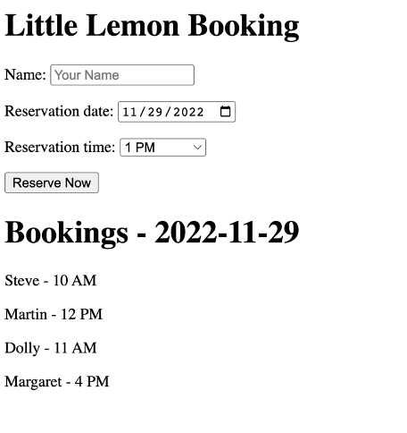

# Display the Little Lemon available booking times

## **Lab assets**

You are provided with a basic setup for the Django environment for the project and app inside the zip file below.

[Display-the-Little-Lemon-available-booking-times-v2.zip](Display-the-Little-Lemon-available-booking-times-v2.zip)

The zip has been extracted to the folder **[Exercise](Exercise/)**. This is the working directory for the lab (it contains **manage.py**). Run all commands from inside it:

```bash
cd Exercise
```

The zip file contains an updated template to be used along with supportive files to run the lab.

**Note:** *The virtual environment using **pipenv** is defined by the [Pipfile](Exercise/Pipfile) and [Pipfile.lock](Exercise/Pipfile.lock) in the extracted folder. The virtual environment itself is not included. You must create and activate it and make sure the dependencies are installed.*

### **Extracted project structure**

```
Exercise/
├── manage.py
├── Pipfile                     # django, mysqlclient; python_version = "3.9"
├── Pipfile.lock
├── db.sqlite3                  # leftover from earlier labs, not used (settings point to MySQL)
├── littlelemon/                # project
│   ├── settings.py             # MySQL config, templates and static dirs (starter code)
│   └── urls.py                 # includes restaurant.urls (starter code)
├── restaurant/                 # app
│   ├── models.py               # Booking and Menu models (starter code)
│   ├── forms.py                # BookingForm (starter code)
│   ├── views.py                # ← YOU EDIT: add bookings() under @csrf_exempt (Steps 5–6)
│   ├── urls.py                 # book/, reservations/, bookings routes already set up
│   ├── admin.py                # registers Menu
│   ├── migrations/             # 0001–0003 already present
│   ├── static/css/style.css
│   └── templates/
│       ├── book.html           # ← YOU EDIT: Step 9–12 placeholders (Parts one to four)
│       ├── bookings.html       # complete, renders /reservations/ as JSON
│       ├── base.html, index.html, about.html, menu.html, menu_item.html
│       └── partials/_header.html, _footer.html
└── static/
```

Your goal is to get reservation data from an API and use JavaScript to show it on the HTML page.

## **Objective**

- Use JavaScript to update the booking form and the page with data from the API

## **Introduction**

In parts one and two of the final assessment, you connected a model and built a form that takes reservation details from users of the Little Lemon website. In this exercise, you must use JavaScript to do the following:

- Create new bookings and refresh current bookings
- Refresh bookings for a date when the date is changed
- Show only the available time slots, which update as bookings change

## **Initial lab instructions**

This lab will require you to modify the following files:

- [restaurant/views.py](Exercise/restaurant/views.py)
- [restaurant/templates/book.html](Exercise/restaurant/templates/book.html)

**Note:** *The original lab text lists **bookings.html**, but the placeholders you need to complete (Steps 9–12) are in **book.html**. **bookings.html** is already complete.*

Starter code has already been added to the following files:

- [littlelemon/settings.py](Exercise/littlelemon/settings.py)
- [restaurant/forms.py](Exercise/restaurant/forms.py)
- [restaurant/models.py](Exercise/restaurant/models.py)
- [restaurant/urls.py](Exercise/restaurant/urls.py) (app-level)
- [littlelemon/urls.py](Exercise/littlelemon/urls.py) (project-level)

Once you set up the project, review the contents of all the files and then follow the steps. The zip file may contain some additional stylesheets and formatting, so use the extracted folder as the starter code instead of building on your existing project from part two.

You have already built the project named **littlelemon** and added an app inside the project called **restaurant**.

Follow the instructions below and check the output after every step.

**Note:** *Make sure you have installed MySQL on your local machine and set up the admin user. To keep this lab simple, you will start with the root user. By default, the root user's password is either **password** or blank. If the password is blank, press Enter. The password does not appear on screen as you type it.*

### **Starter code notes (from the extracted files)**

- **Database settings** in [settings.py](Exercise/littlelemon/settings.py) are already set to MySQL:

  ```python
  DATABASES = {
      'default': {
          'ENGINE': 'django.db.backends.mysql',
          'NAME': 'reservations',
          'HOST' : '127.0.0.1',
          'PORT' : '3306',
          'USER' : 'root',
          'PASSWORD' : 'root@123',
      }
  }
  ```

  Change `USER`/`PASSWORD` to match your local MySQL setup, for example the `admindjango` / `employee@123!` user from the [Connect lab](../Connect/).

- **views.py doesn't run as shipped.** The file ends with a bare `@csrf_exempt` decorator and no function under it, so Python raises a `SyntaxError`. Until you add `bookings()` in Steps 5–6, every `manage.py` command fails, including `migrate` and `runserver`. **Do Steps 5–6 before Step 4**, or comment out the decorator for now.
- **URL routes** in [urls.py](Exercise/restaurant/urls.py):
  - `book/` → `views.book`. The booking page, where you do your work.
  - `reservations/` → `views.reservations`. Lists all bookings as JSON (bookings.html).
  - `bookings` → `views.bookings`. The JSON API you write in Step 6. It has **no trailing slash**, and `book.html` calls it as ``.
- **views.py** already imports `json`, `serializers`, `Booking`, `datetime`, `csrf_exempt` and `HttpResponse`. The `book()` and `reservations()` views are complete.
- **Booking model** has these fields: `first_name`, `reservation_date` (DateField) and `reservation_slot` (SmallIntegerField, default 10). Slots are hours, and `formatTime()` in book.html turns them into labels like `10 AM` or `7 PM`.
- **Migrations** `0001`–`0003` already exist, so `makemigrations` should report no changes.
- **Possible date bug:** book.html sets today's date with `${date.getMonth() + 1}`, which doesn't add a leading zero. From January to September this produces an invalid value such as `2026-3-05`, so the date input stays empty and the first `getBookings()` call fails. If that happens, change it to `` `${(date.getMonth() + 1).toString().padStart(2, "0")}` ``.

This is part three of the final assessment. It uses JavaScript to change the view logic and the booking template that processes the booking form data.

# **Steps**

**Step 1:**

Run the following command to activate the virtual environment:

**pipenv shell**

**Note:** *Run the command in the main working directory that contains the **manage.py** file, which is `Exercise/`.*

**Step 2:**

To make sure you have the necessary dependencies in place, run the following commands inside **pipenv**:

**pipenv install django**

**pipenv install mysqlclient**

**Note:** *On macOS, `mysqlclient` needs the MySQL client libraries to build (for example, `brew install mysql pkg-config`).*

**Step 3:**

Check the code in all the supporting files you need for the exercise. It includes a few changes from the end of part two. See **Starter code notes** above.

**Step 4:**

In the terminal, run both migration commands:

**python manage.py makemigrations**

**python manage.py migrate**

**Note:** *Make sure you have created the correct MySQL user, assigned privileges, and created the database named in settings.py (**reservations**) before you run the migrations.*

Run the necessary commands to make sure the user is created and can access the database. If you are using the root user, make sure **settings.py** has the correct root password.

**Note:** *You don't strictly need these migrations, because the changes are already in place. Still, it's good practice to run migrations before you start on new code. As explained above, these commands fail with a `SyntaxError` until you complete Steps 5–6.*

**Step 5:**

Open the file [views.py](Exercise/restaurant/views.py) and create a view function called **bookings()** below the **@csrf_exempt** decorator at the end of the file. The function should take a request object as an argument.

**Note:** *The necessary imports are already in the **views.py** file. The URL configuration for the view function is already in the app-level **urls.py** file (`path('bookings', views.bookings, name='bookings')`).*

**Step 6:**

Inside the view function **bookings()**, add the following pseudo code:

- If value of **request.method** is equal to **"POST"**
    - Create a variable called **data** and assign it the value of **json.load()** with the **request** object passed as an argument.
    - Create a variable called **exist** and assign the following value to it:
        - **Booking.objects.filter(reservation_date=data['reservation_date']).filter( )**
        - Inside the second **filter()** call, pass the keyword argument **reservation_slot=data['reservation_slot']**. Then add **.exists()** to the end of the call:
            - `.filter(reservation_slot=data['reservation_slot']).exists()`
    - If the value of the **exist** variable is **False**:
        - Create a variable called **booking** and assign the value of the **Booking()** class object with the following code passed inside it:
            - **first_name=data['first_name'],**
            - **reservation_date=data['reservation_date'],**
            - **reservation_slot=data['reservation_slot'],**
        - Call the **save()** function over the **booking** variable using the dot operator.
    - Else return **HttpResponse()** with the following arguments passed inside it:
        - **"{'error':1}"** as a string
        - Variable **content_type** with the value equal to **'application/json'**
- Create a variable called **date** and assign it the value:
    - **request.GET.get('date',datetime.today().date())**
- Create a variable called **bookings** and assign it the value:
    - **Booking.objects.all().filter(reservation_date=date)**
- Create a variable called **booking_json** and assign it the value:
    - **serializers.serialize('json', bookings)**
- Return **HttpResponse()** with the following arguments passed inside it:
    - **booking_json**
    - Variable **content_type** with the value equal to **'application/json'**

**Note:** *The last block (`date`, `bookings`, `booking_json` and the return) is at the function level, not inside the `if`. It runs for both GET and POST requests.*

**Step 7:**

Save the **views.py** file. Make sure the code has no errors and that you followed the pseudo code exactly.

**Step 8:**

Now open the [book.html](Exercise/restaurant/templates/book.html) file and look at the code. There are four code blocks for you to complete. Each is marked with a comment like this:

**<!-- Step 9: Part one -->**

Replace each comment with the code described in the four steps below:

| Step | Placeholder in book.html | Where |
| --- | --- | --- |
| 9 | `<!-- Step 9: Part one -->` | Inside the empty `<p>` in the form, between the name and time fields |
| 10 | `/*  Step 10: Part two */` | In the `<script>`, after the first `getBookings()` call |
| 11 | `/* Step 11: Part three */` | Inside `getBookings()`, in the `.then(data => { ... })` block |
| 12 | `/* Step 12: Part four  */` | Right below Part three, before `slot_options` is used |

**Step 9 (for part one):**

Look at the code inside the paragraph tag for the first name. Copy it for the reservation date and use it to replace the placeholder comment. Use a `<label for="reservation_date">` and an `<input type="date" id="reservation_date">`. The script looks up this exact `id`.

**Step 10 (for part two):**

Call a function **getElementById()** over the **document** with **'reservation_date'** passed inside it as an argument.

Then, on the same line, use the dot operator to call **addEventListener()** on the result and pass it the following arguments:

**'change'**

**a function that contains the code: {getBookings()}**

**Step 11 (for part three):**

Run a for loop on the constant **data**. Use a temporary variable called **item** to run the loop (`for (const item of data) { ... }`). Add the following code inside the curly braces:

- Call a **log()** function over the console and pass **item.fields** as an argument
- Call a **push()** function over **reserved_slots** array and pass the **item.fields.reservation_slot** to it as an argument

Add the following code to the **bookings** string variable with `+=`:

**`<p>${item.fields.first_name} - ${formatTime(item.fields.reservation_slot)}</p>`**

**Step 12 (for part four):**

Create a variable called **slot_options** and assign the following string to it:

**'<option value="0" disabled>Select time</option>'**

Run a for loop from **10** up to, but not including, **20** (`for (let i = 10; i < 20; i++)`). This covers the slots 10 AM–7 PM, and 10 is the model's default slot. Add the following code inside the curly braces:

Create a constant called **label** and assign it the result of **formatTime()**, with **i** passed in as an argument.

If value of **reserved_slots.includes(i)** is true add the code:

**slot_options += `<option value=${i} disabled>${label}</option>`**

Else, add the code:

**slot_options += `<option value=${i}>${label}</option>`**

**Note:** *Make sure all the code blocks have curly braces where they need them.*

**Step 13:**

Save the file and make sure your HTML file has no visible errors.

Now open the **Terminal** in VS Code and run the server:

**python manage.py runserver**

Then go to http://127.0.0.1:8000/book/ (or click **Book** in the menu) and look at the page.

**Step 14:**

Enter your name in the text box and choose a date and time to create a reservation.

The screen should look similar to the one below:



**Step 15:**

After you choose the options and click the **Reserve** button, the screen updates with your details. The times you booked earlier can no longer be selected.


**Step 16:**

When you change the date, the content on the screen changes to show that date's bookings:


**Step 17:**

Open the MySQL database and look at the entries. They match the reservations you made on the page. For example:

```sql
SELECT * FROM reservations.restaurant_booking;
```

You can also open http://127.0.0.1:8000/reservations/ to see all bookings as JSON.
